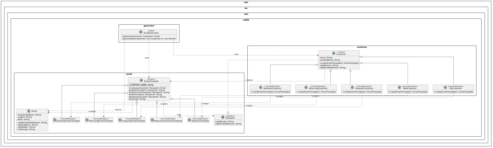

| CS-665       | Software Design & Patterns |
|--------------|----------------------------|
| Name         | Jiafu Guo                  |
| Date         | 11/03/2026                 |
| Course       | Fall 2026                  |
| Assignment # | 3                          |

# Assignment Overview

A company serves five customer segments: Business, Returning, Frequent, New and VIP. This
project is the "Email Generation" application that writes a personalized email for any
customer: every email follows one base template (greeting, introduction, offer, closing), the
greeting uses the customer's name, and the subject, introduction and offer depend on the
customer's segment.

There is no graphical or command line user interface. The user interactions are implemented
as JUnit tests, as required by the assignment; `Main` only runs a short console demo that
prints one email per segment with Log4j.

# GitHub Repository Link:
https://github.com/guojiafu-jeff/cs-665-assignment-3

# Implementation Description

## Design overview

The code is organized in three packages. Package dependencies go in one direction only:
`generator` → `customer` → `email`.

| Package | Classes | Responsibility |
|---|---|---|
| `edu.bu.met.cs665.email` | `Recipient` (interface), `Email`, `EmailTemplate` (abstract), `BusinessEmailTemplate`, `ReturningEmailTemplate`, `FrequentEmailTemplate`, `NewCustomerEmailTemplate`, `VipEmailTemplate` | The email subsystem: what an email is, the base template, and the five segment templates. It knows nothing about customers; it only needs a `Recipient` (a name and an address). |
| `edu.bu.met.cs665.customer` | `Customer` (abstract), `BusinessCustomer`, `ReturningCustomer`, `FrequentCustomer`, `NewCustomer`, `VipCustomer` | One class per customer segment. Each segment decides which template it receives through the factory method `createEmailTemplate()`. |
| `edu.bu.met.cs665.generator` | `EmailGenerator` | The entry point of the application: generate the email for one customer or for a list of customers. |

Using the application takes two lines:

```java
EmailGenerator generator = new EmailGenerator();
Email email = generator.generate(new VipCustomer("E", "E@gmail.com"));
// email.getSubject() -> "An exclusive invitation for our VIP member E"
```

How the classes work together:

- `EmailGenerator.generate(customer)` asks the customer for its template with
  `customer.createEmailTemplate()`. This is the factory method: `Customer` declares it as
  abstract, and each concrete customer class returns its own `EmailTemplate` subclass. The
  generator never names a concrete customer or template class and contains no `if` on the
  customer type.
- `EmailTemplate.compose(recipient)` is the base template. It is a `final` method that
  assembles the email in a fixed order: greeting, introduction, offer, closing. The greeting
  ("Dear <name>,") and the closing are implemented once in `EmailTemplate`; `subject()`,
  `introduction()` and `offer()` are abstract and are filled in by the five concrete templates.
- `compose()` returns an `Email`, an immutable value object with the recipient address, the
  subject and the body.

Factory Method roles:

| Role | Class |
|---|---|
| Product | `EmailTemplate` |
| ConcreteProduct | `BusinessEmailTemplate`, `ReturningEmailTemplate`, `FrequentEmailTemplate`, `NewCustomerEmailTemplate`, `VipEmailTemplate` |
| Creator (declares the factory method `createEmailTemplate()`) | `Customer` |
| ConcreteCreator | `BusinessCustomer`, `ReturningCustomer`, `FrequentCustomer`, `NewCustomer`, `VipCustomer` |
| Client | `EmailGenerator` |

Errors: all public entry points validate their arguments and throw `IllegalArgumentException`
for a null customer, a null recipient, or a customer with a blank name or address. A rejected
call creates nothing.

## Assumptions

1. There are exactly five customer segments and they are mutually exclusive. A customer belongs
   to one segment and is represented by one class.
2. An email consists of a recipient address, a subject line and a body. The body always has four
   parts in this order: greeting, introduction, offer, closing.
3. Personalization has two sources: the customer's name (used in the greeting and in some
   subjects) and the customer's segment (which selects the subject, introduction and offer).
4. The application generates the email text only and does not include any other function.
5. A customer needs a name and an email address, both non-blank. The format of the address is
   not validated.
6. The marketing copy in the five templates is example text. Changing the wording for one
   segment means editing that segment's template class only.
7. Templates are stateless, so one template object could be reused for many customers; the
   factory method simply creates a new one per call because that is the simplest correct choice.

## Flexibility

- A new segment (for example Student) is two new classes, `StudentCustomer` and
  `StudentEmailTemplate`, and no change to any existing file. `EmailGenerator` and `Customer`
  depend only on the abstract types, so they are closed for modification and open for extension.
- Because `createEmailTemplate()` is abstract, the compiler refuses a new customer class that
  forgot to choose its template.
- Changing the shared structure of all emails (for example adding a footer with an
  unsubscribe link) is one change in `EmailTemplate.compose()` or `closing()`.
- A segment that needs a different greeting can override the `greeting()` hook without touching
  the other segments.
- Segment-specific data can be added later: a `BusinessCustomer` could carry a company name and
  pass it to its template in `createEmailTemplate()` (`new BusinessEmailTemplate(companyName)`),
  which is exactly the hook the Factory Method pattern provides.
- The `email` package depends only on the small `Recipient` interface, so the same templates
  could serve other recipients (employees, sales leads) that implement it.

## Simplicity and understandability

- Three packages mirror the three ideas of the problem: the email subsystem, the customer
  segments, and the generator that connects them. Dependencies go one way, so there are no
  cycles to understand.
- The whole public API is `EmailGenerator.generate()` and `generateAll()`; the class names read
  like the assignment text (`VipCustomer`, `VipEmailTemplate`).
- The two class hierarchies are parallel and identical in shape: five customers, five templates,
  one line connecting each pair. Once one pair is understood, all five are.
- Every file and method has a documentation comment, and `Email.toString()` prints an email the
  way a mail client shows it, so log output and test failures are readable.

## Avoiding duplicated code

- The email structure (order of sections, separators, greeting, closing) exists once, in
  `EmailTemplate`. The five templates contain only the text that differs.
- The customer fields and their validation exist once, in `Customer`. The five customer classes
  contain only a constructor and the one-line factory method.
- The knowledge "which segment gets which template" exists once per segment, in that
  segment's `createEmailTemplate()`. There is no `if`/`instanceof` chain anywhere, so that
  knowledge cannot drift between several copies.

Why it matters: a rule that lives in one place is changed in one place, behaves the same
everywhere and is tested once, which means fewer bugs.

## Design patterns

- **Factory Method**. `Customer` is the Creator and declares
  the factory method `createEmailTemplate()`; the five customer classes are the
  ConcreteCreators; `EmailTemplate` is the Product and the five templates are the
  ConcreteProducts; `EmailGenerator` is the client that calls the factory method. It was chosen
  because the problem is exactly the one the pattern solves: the generator knows *when* a
  template object is needed (every time an email is generated) but must not know *which*
  concrete class to instantiate, since that depends on the customer segment. Letting each
  customer class make that decision removes every conditional on the customer type and lets
  new segments be added without modifying existing code.

## Tests

`TestEmailGenerator` creates at least one customer of every segment and checks the generated
emails:

- five tests, one per segment, check the recipient address, the greeting with the customer's
  name and the segment-specific subject and offer text;
- the five segments produce five different subjects and five different bodies;
- every email shares the base template (same greeting form, same closing);
- batch generation returns one email per customer in the input order;
- a null customer and a customer with a blank name are rejected with
  `IllegalArgumentException`.

Run them with `mvn clean test` (10 tests).

## Use of AI assistance

I discussed the design and the Factory Method pattern with Claude, used it to write each customer segment's email content, and used it to help with the PlantUML code for the UML diagram and the formatting of this README.

# UML Class Diagram



The same diagram as a PDF: [uml/UML.pdf](uml/UML.pdf). Factory Method: `Customer` is the
Creator with the factory method `createEmailTemplate()`, `EmailTemplate` is the Product, the
five customer classes and the five template classes are the concrete creators and products,
and `EmailGenerator` is the client.

# Project Template Notes

The sections below come from the CS-665 Java project template and describe the build setup.

## Features included

- Java 25 Maven configuration with `maven.compiler.release` set to `25`
- Log4j 2 logging configuration in `src/main/resources/log4j2.xml`
- JUnit testing support
- JaCoCo coverage reports
- SpotBugs static analysis
- Checkstyle configuration under `config/`

## Prerequisites

Before building, install:

- Java 25 JDK
- Apache Maven 3.9 or newer

Check your environment with:

```bash
java -version
mvn -version
```

If Maven reports an older Java version, update `JAVA_HOME` and `PATH` so Maven uses JDK 25. For example on macOS:

```bash
export JAVA_HOME="$(/usr/libexec/java_home -v 25)"
export PATH="$JAVA_HOME/bin:$PATH"
mvn -version
```

## Build and run

Compile the project:

```bash
mvn clean compile
```

Run the unit tests:

```bash
mvn clean test
```

Generate coverage and build reports:

```bash
mvn clean verify
```

Run the demo (one customer of each segment, one email each):

```bash
mvn compile exec:java
```

Launch the SpotBugs GUI:

```bash
mvn spotbugs:gui
```

Generate the Checkstyle report:

```bash
mvn checkstyle:checkstyle
```

## Useful reports

After running verification, inspect the generated reports in the `target/` directory:

- JaCoCo: `target/site/jacoco/index.html`
- Checkstyle HTML: `target/site/checkstyle.html`

## Notes

SpotBugs reports one `CT_CONSTRUCTOR_THROW` finding for `Customer`: its constructor throws
`IllegalArgumentException` for a blank name or address, and the class cannot be declared
`final` because it is the abstract base of the five segment classes. The finding is accepted;
`Email`, the other validating class, is `final`. Checkstyle warnings concern the 4-space
indentation used throughout the project.
